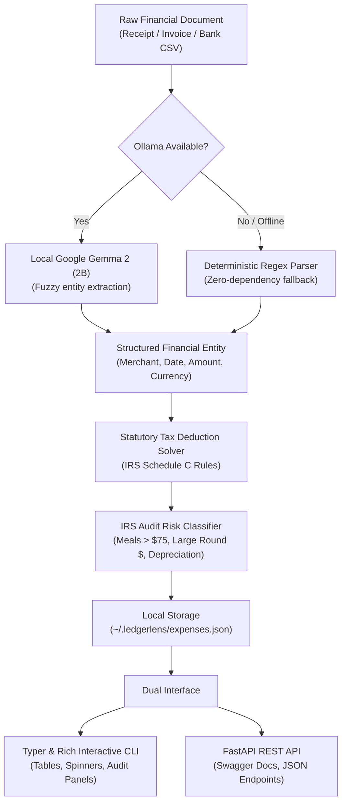

<div align="center">

# 🧾 LedgerLens

### Privacy-First Local AI Bookkeeper & Tax Deduction Engine for Freelancers

<p align="center">
  <a href="#-the-story-the-4000-deduction-leak"><strong>The Story</strong></a> &nbsp;•&nbsp;
  <a href="#-how-it-works"><strong>How It Works</strong></a> &nbsp;•&nbsp;
  <a href="#-quickstart"><strong>Quickstart</strong></a> &nbsp;•&nbsp;
  <a href="#-cli-commands"><strong>CLI Commands</strong></a> &nbsp;•&nbsp;
  <a href="#-tests"><strong>Tests</strong></a>
</p>

[](https://dev.to)
[](https://python.org)
[](https://fastapi.tiangolo.com)
[](https://typer.tiangolo.com)
[-4285F4.svg?style=for-the-badge)](https://ai.google.dev/gemma)
[](tests/)
[](LICENSE)

<br />

> *"AI understands messy receipt text. Deterministic tax rules calculate your write-offs."*

---

</div>

## 💌 The Story: The $4,000 Deduction Leak

Independent software engineers, freelancers, and solopreneurs face an agonizing administrative chore at tax time. 

Receipts from software subscriptions, cloud compute, coffee meetings with clients, and hardware upgrades scatter across email inboxes, photo rolls, and download folders. Industry estimates reveal that the average freelancer misses out on **over $4,000 in legitimate annual business tax write-offs** simply because tracking expenses manually is exhausting.

Existing solutions force a painful compromise:
1. **The Cloud Privacy Trap**: Commercial apps (Expensify, QuickBooks) and cloud LLM wrappers require uploading confidential client invoices, customer names, bank statements, and proprietary contracts to third-party cloud servers.
2. **The Subscription Tax**: Freelancers are charged $30 to $60 every single month for basic categorization tools.
3. **The LLM Hallucination Danger**: Generic LLMs hallucinate financial math, creating severe IRS audit risks.

**LedgerLens was built as a privacy-first side-hustle utility:** it parses unstructured financial documents locally using **Google Gemma 2 (2B)**, applies deterministic statutory tax deduction rules (IRS Schedule C guidelines), and flags audit risks—with **100% data sovereignty and zero cloud leakage**.

---

## 💡 How It Works



### The Architectural Thesis: *"Gemma understands. Code computes."*
* **Google Gemma 2 (2B)** handles fuzzy entity extraction: finding dates, currencies, line items, and merchant names across diverse receipt formats.
* **Deterministic Python Code** handles the tax math: calculating statutory deduction percentages (e.g. 50% for client meals, 100% for software and cloud hosting, Section 179 equipment rules) and flagging audit hazards.

---

## ⚖️ Comparison: Traditional SaaS vs. Cloud AI vs. LedgerLens

| Feature | Accounting SaaS (QuickBooks) | Cloud AI Wrappers | **LedgerLens** 🧾 |
| :--- | :---: | :---: | :---: |
| **Data Privacy** | ❌ Vendor servers | ❌ Transmitted to Cloud LLMs | **✅ 100% Local Device** |
| **Recurring Cost** | $30 - $60 / month | $20 / month + API tokens | **✅ $0 / Free & Open Source** |
| **Offline Capability** | ❌ No | ❌ No | **✅ 100% Functional Offline** |
| **Math Reliability** | ✅ High | ❌ Hallucination Risk | **✅ Deterministic Solver** |
| **Audit Risk Flags** | ⚠️ Generic | ❌ None | **✅ IRS Schedule C Rules** |
| **Developer Friendly** | ❌ Rigid UI | ⚠️ Chatbot only | **✅ Dual CLI & REST API** |

---

## ✨ Key Features

* 🧠 **Hybrid Local AI**: Ingests messy text using on-device Google Gemma 2B with automatic fallback to a zero-dependency regex engine.
* ⚖️ **Statutory Schedule C Rules**: Accurately computes deductible rates (50% client meals, 100% cloud & software, hardware equipment safe harbor).
* 🚨 **Automated Audit Risk Detector**: Flags high-risk IRS red flags (meals > $75/$150 lacking attendee records, large round numbers, depreciable assets > $2,500).
* 🖥️ **Interactive Terminal CLI**: Beautiful formatting with spinners, deduction summary panels, and colored audit alerts powered by Typer and Rich.
* 🌐 **FastAPI REST Service**: Production-ready endpoints and interactive Swagger API documentation (`/docs`).
* 📁 **Audit-Ready CSV Export**: One-click export for CPAs and tax preparers.

---

## ⚡ Quickstart

### Prerequisites
- **Python**: Version 3.10+
- **Ollama** *(optional for local Gemma 2B; deterministic engine runs with zero external tools)*: Download from [ollama.com](https://ollama.com/)

### 3-Step Setup

```bash
# 1. Clone repository
git clone https://github.com/tribhu05/LedgerLens.git
cd LedgerLens

# 2. Install dependencies
pip install -r requirements.txt

# 3. Verify AI connection
python -m ledgerlens.cli health
```

---

## 🖥️ CLI Commands

```bash
# Scan a receipt text file or raw transaction string
python -m ledgerlens.cli scan sample_receipts/figma_subscription.txt

# Scan with inline string
python -m ledgerlens.cli scan "Blue Bottle Coffee $14.50 on 2026-10-12 Client meeting"

# View all logged expenses in a Rich table
python -m ledgerlens.cli list

# View tax deduction analytics and projected tax savings
python -m ledgerlens.cli summary

# Export audit-ready CSV for tax filing
python -m ledgerlens.cli export --output my_2026_deductions.csv

# Launch the FastAPI REST server
python -m ledgerlens.cli serve --port 8000
```

---

## 🌐 FastAPI Endpoints

| Method | Endpoint | Description |
| :--- | :--- | :--- |
| `GET` | `/` | Service health and engine metadata |
| `GET` | `/api/health` | Live latency check for local Ollama and Gemma 2B |
| `POST` | `/api/expenses/parse` | Parse receipt text into structured JSON |
| `POST` | `/api/expenses/scan` | Parse receipt, calculate deductions, and save to ledger |
| `GET` | `/api/expenses` | List recorded expenses with optional `?category=` filter |
| `GET` | `/api/tax-summary` | Aggregated Schedule C deductions & audit alerts |
| `DELETE` | `/api/expenses/{id}` | Delete an expense by ID |

---

## 🧪 Testing & Verification

LedgerLens includes a comprehensive automated test suite covering all business logic, parsers, tax rules, API endpoints, and CLI commands:

```bash
# Run the test suite
python -m pytest tests/ -v
```

### Verified Test Results
```text
tests/test_api.py::test_root_endpoint PASSED
tests/test_api.py::test_health_endpoint PASSED
tests/test_api.py::test_parse_endpoint PASSED
tests/test_api.py::test_scan_and_save_endpoint PASSED
tests/test_cli.py::test_cli_health PASSED
tests/test_cli.py::test_cli_scan_text PASSED
tests/test_cli.py::test_cli_list PASSED
tests/test_cli.py::test_cli_summary PASSED
tests/test_cli.py::test_cli_export PASSED
tests/test_cli.py::test_cli_clear PASSED
tests/test_engine.py::test_heuristic_parser_figma PASSED
tests/test_engine.py::test_heuristic_parser_coffee_meal PASSED
tests/test_engine.py::test_heuristic_parser_month_name_date PASSED
tests/test_engine.py::test_create_expense_from_text PASSED
tests/test_engine.py::test_check_health PASSED
tests/test_storage.py::test_storage_lifecycle PASSED
tests/test_tax_rules.py::test_deduction_rates PASSED
tests/test_tax_rules.py::test_calculate_deduction_meals PASSED
tests/test_tax_rules.py::test_calculate_deduction_software PASSED
tests/test_tax_rules.py::test_classify_known_merchants PASSED
tests/test_tax_rules.py::test_classify_by_keywords PASSED
tests/test_tax_rules.py::test_evaluate_audit_risk_normal PASSED
tests/test_tax_rules.py::test_evaluate_audit_risk_high_meal PASSED
tests/test_tax_rules.py::test_evaluate_audit_risk_medium_meal PASSED
tests/test_tax_rules.py::test_evaluate_audit_risk_large_round_number PASSED

========================= 25 passed in 2.14s =========================
```

---

## 📜 License

Distributed under the [MIT License](LICENSE).

<div align="center">

**Built for solopreneurs, freelancers, and independent creators everywhere.** 🧾

</div>
